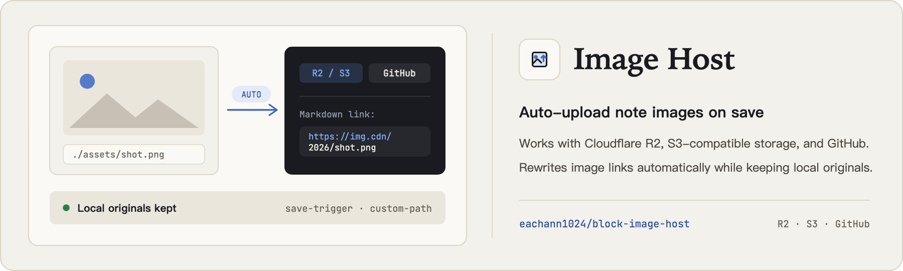

<picture>
  <source media="(prefers-color-scheme: dark)" srcset="assets/card-en-dark.png">
  <source media="(prefers-color-scheme: light)" srcset="assets/card-en-light.png">
  
</picture>

- **Flexible targets**: Upload to Cloudflare R2, any S3-compatible bucket, or a GitHub repo.
- **Zero-friction**: Automatically uploads local images and rewrites links when you save.
- **Safe by default**: Custom path templates and filters; local originals are never deleted.

**Install**: Open Block Settings -> App Store and search **Image Host**, or enter `eachann1024/block-image-host`.
