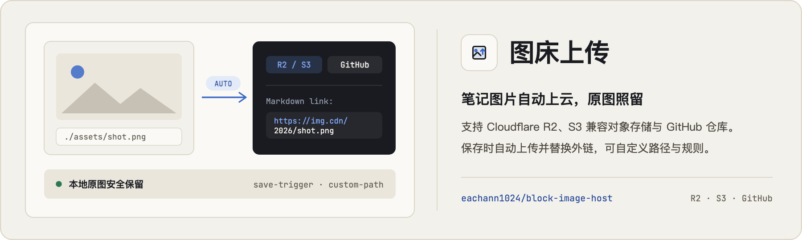

<picture>
  <source media="(prefers-color-scheme: dark)" srcset="assets/card-zh-dark.png">
  <source media="(prefers-color-scheme: light)" srcset="assets/card-zh-light.png">
  
</picture>

- **主流图床直连**：支持 Cloudflare R2、任意 S3 兼容存储与 GitHub 仓库。
- **保存自动上传**：保存笔记时自动把本地图片上传并替换成外链。
- **保留本地原图**：支持自定义命名规则与上传范围，替换链接不删原图。

**安装**：打开 Block「设置 → 应用商店」搜索 **图床上传**，或手动填入 `eachann1024/block-image-host`。
